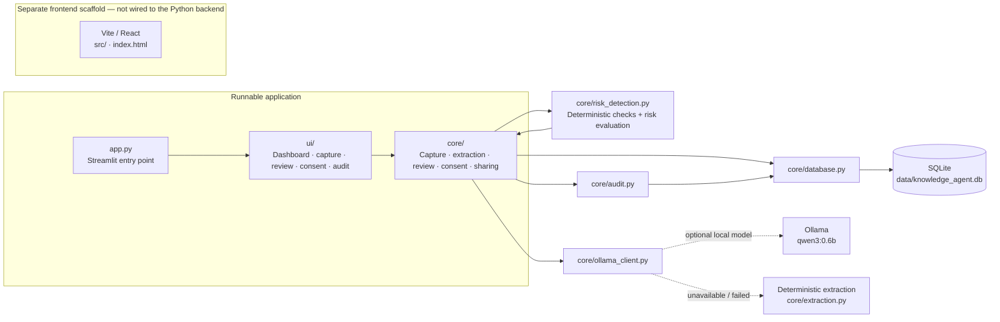
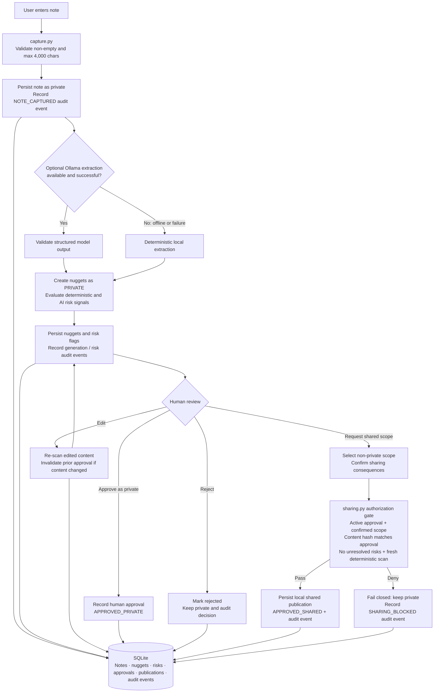

# Trustworthy Personal Knowledge Agent

A local, privacy-first personal knowledge management prototype that transforms unstructured work notes into reusable **knowledge nuggets** while guaranteeing human control over privacy, review, approval, and sharing.

> **Core Security Principle:** AI may suggest knowledge and recommend sharing scopes, **but only the human user can authorize sharing.**

---

## Key Features

- **100% Local & Offline-Capable:** Uses local SQLite storage and optional local Ollama (`qwen3:0.6b`), with an automatic deterministic extraction fallback when Ollama is offline. No cloud APIs, external databases, or paid keys required.
- **Private by Default:** Every captured note, generated nugget, failed extraction, or edited nugget starts and remains `PRIVATE` until explicitly approved by a human.
- **Multi-Layer Risk Detection:** Deterministic rules + optional AI signals detect:
  1. Personal information (emails, phone numbers, SSN/identifier labels)
  2. Credentials and secrets (passwords, API keys, access tokens, private keys)
  3. Confidential information (confidentiality/NDA/internal-only wording)
  4. Unsupported claims (absolute/unverified metrics or claims beyond the source note)
- **Human-in-the-Loop Review & Editing:** Edit titles, content, and topic tags. Any edit to an approved nugget automatically invalidates prior approval, reverts scope to `PRIVATE`, and re-runs deterministic risk detection.
- **Explicit Sharing Consent & Backend Authorization:** Non-private scopes (`PROJECT_TEAM`, `DEPARTMENT`, `ORGANISATION`) require a consequence-confirmation dialog and pass an independent 4-condition backend authorization gate.
- **Prompt Injection Defense:** Note content is framed as untrusted data; instructions embedded in notes cannot trigger approval or sharing.
- **4-Stage Content Provenance:** Distinguishes Original Input, AI-Generated Suggestion, Human-Edited Version, and Human-Approved Version.
- **Append-Only Audit Trail:** Persists lifecycle events in SQLite with database triggers preventing silent updates or deletions and automatic redaction of sensitive raw values.
- **Duplicate Submission Protection:** Clears the note input as soon as processing is submitted, preventing duplicate captures if downstream extraction fails (while preserving drafts on validation errors).

---

## Architecture Overview

The runnable application is a local Streamlit app. `app.py` composes the screens in `ui/`, which call the domain and security workflows in `core/`. Those workflows persist notes, nuggets, approvals, publications, and audit events in SQLite. Ollama is an optional local extraction provider; deterministic extraction is used when it is unavailable.

The repository also contains a separate React/Vite scaffold in `src/`. It is not connected to the Python backend; the current `src/App.tsx` is an empty placeholder. The `npm run dev` script starts the Streamlit app through `dev-server.mjs`.

### Architecture Diagram



### Data-Flow Diagram



---

## Prerequisites

- **Python 3.11+**
- **pip** (or Python virtual environment)
- **Ollama** *(optional — the application runs fully offline without Ollama via deterministic fallback)*

---

## Installation

1. Create and activate a virtual environment (recommended):

   ```bash
   python3 -m venv .venv
   source .venv/bin/activate
   ```

2. Install dependencies:

   ```bash
   pip install -r requirements.txt
   ```

---

## Optional: Installing & Running Ollama (`qwen3:0.6b`)

1. Install Ollama from [https://ollama.com/download](https://ollama.com/download) (or on Linux: `curl -fsSL https://ollama.com/install.sh | sh`).
2. Start the Ollama service:

   ```bash
   ollama serve
   ```

3. Download the preferred lightweight local model:

   ```bash
   ollama pull qwen3:0.6b
   ```

If Ollama is not installed or stopped, the application automatically switches to its deterministic local extractor and logs the fallback in the terminal.

---

## Starting the Application

```bash
streamlit run app.py
```

Open the local URL printed by Streamlit (typically `http://localhost:8501`).
All local data and logs are stored strictly inside `data/` (`data/knowledge_agent.db` and `data/logs/agent.log`).

---

## Running Automated Tests

Run the full Pytest suite:

```bash
pytest -v
```

The test suite verifies:
- Backend 4000-character enforcement, Pydantic schema validation, and safe failure modes
- Prompt injection resistance (notes attempting to force sharing or auto-approval remain `PRIVATE`)
- Risk detection across all 4 categories and immunity to AI override
- Approval binding to exact content hashes and automatic invalidation on edits
- Independent 4-condition backend sharing authorization
- Append-only audit logging, sensitive text redaction, and persistence across database restarts
- End-to-end Streamlit UI workflows via `AppTest`

---

## Privacy & Security Limitations

- **Single-User Local Prototype:** This prototype has no multi-user authentication or OS-level user isolation; it assumes the operator on the local machine is the sole owner of the database.
- **Simulated Sharing:** Sharing (`PROJECT_TEAM`, `DEPARTMENT`, `ORGANISATION`) writes to a local `shared_publications` SQLite table rather than integrating with an external intranet, Slack, or Confluence API.
- **Deterministic Pattern Limits:** Regex-based PII, secret, and confidentiality detection catches common structured formats (emails, phone numbers, SSNs, standard API key prefixes, restriction keywords) but cannot catch every novel or domain-specific secret without human review.
- **Local Model Accuracy:** Small local models such as `qwen3:0.6b` can occasionally produce incomplete JSON or hallucinate phrasing; the backend mitigates this via Pydantic validation, fail-safe `PRIVATE` defaults, source provenance preservation, and mandatory human approval.
- **Database File Access:** SQLite stores notes and nuggets unencrypted on the local filesystem inside `data/knowledge_agent.db`; rely on OS full-disk encryption and file permissions for at-rest protection.

---

## Project Structure

```text
personal-knowledge-agent/
├── .env.example
├── .gitignore
├── app.py                         # Streamlit application entry point
├── dev-server.mjs                 # npm dev wrapper for Streamlit
├── index.html
├── logging_config.py
├── metadata.json
├── package.json                   # React/Vite tooling
├── requirements.txt               # Python dependencies
├── tsconfig.json
├── vite.config.ts
├── README.md
├── core/
│   ├── models.py · database.py · audit.py
│   ├── capture.py · extraction.py · ollama_client.py
│   └── risk_detection.py · review.py · consent.py · sharing.py
├── data/                          # Local SQLite database and logs
├── src/                         # Separate React/Vite scaffold; not backend-connected
│   ├── App.tsx                  # Placeholder
│   ├── main.tsx
│   └── index.css
├── tests/
│   └── pytest suite for core workflows and Streamlit UI
└── ui/                           # Streamlit screens and components
```
